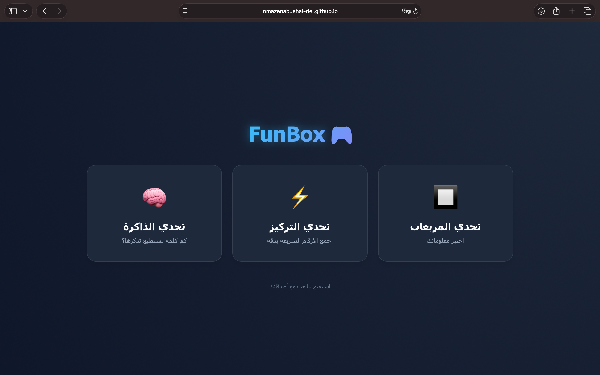
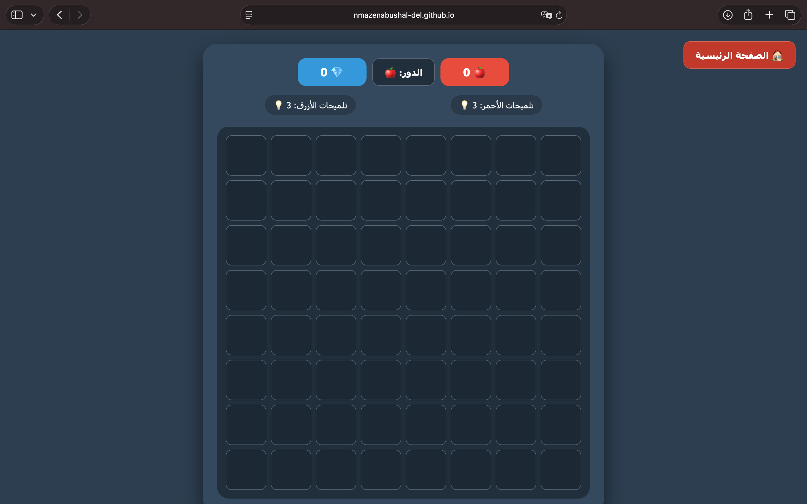
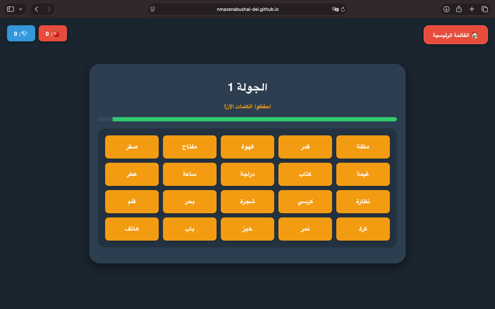
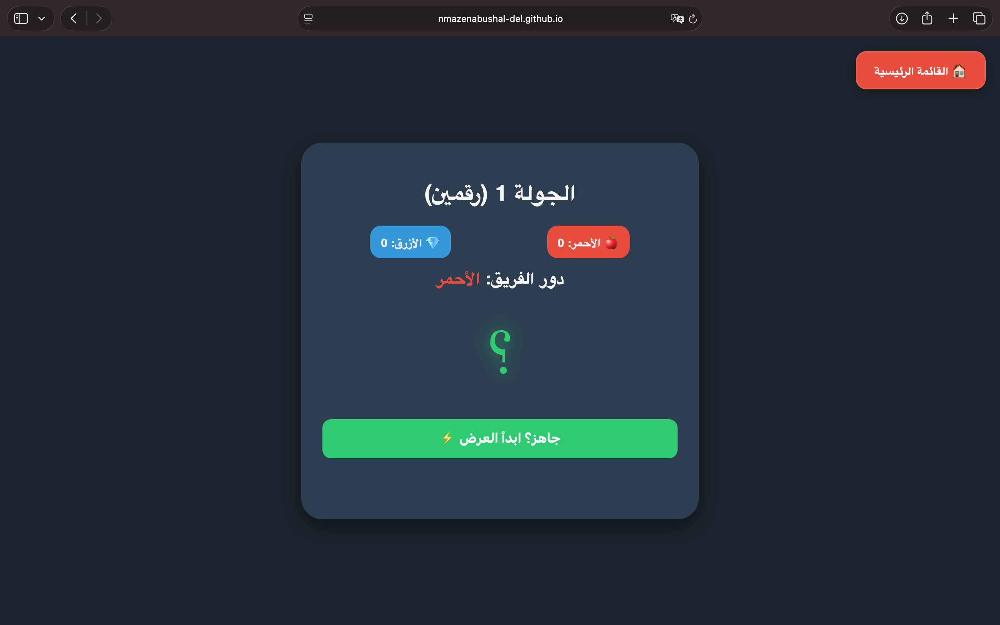

# 🎮 FunBox

An Arabic party-games website where two teams (🍎 Red vs 💎 Blue) compete in fun brain challenges.
No installation needed: it runs directly in the browser.

## ▶️ Play it here
👉 https://noorulhuda-abushal.github.io/FunBox/funBox/

## 🕹 The Games

### 🔲 Squares Challenge
- An 8×8 board where every square hides a question (general knowledge, science, religion, riddles)
- Answer correctly to claim the square
- **First team to connect 5 squares in a row** (horizontal, vertical, or diagonal) wins
- Each team gets 3 hints that reveal the first letter of the answer

### ⚡ Focus Challenge
- Numbers flash on the screen very quickly (a quarter of a second each)
- The team must type the correct sum within 30 seconds
- Gets harder each round: from 2 numbers up to 6

### 🧠 Memory Challenge
- 20 words appear for 20 seconds, then disappear
- Each team writes down as many words as they remember
- 4 rounds, and the team with the most correct words wins

## ✨ Features
- Live scoreboard for both teams
- Timers and progress bars
- Instructions screen before each game
- Undo option to fix mistakes
- Fully in Arabic (right-to-left layout)

## 🛠 Built With
- HTML
- CSS
- JavaScript (no libraries)

## 📁 Files
- `index.html`: main menu
- `squar.html`: Squares Challenge
- `number.html`: Focus Challenge
- `photo.html`: Memory Challenge
